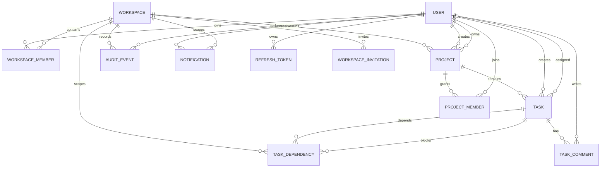

# Architecture

## Runtime topology

```text
Vanilla JS SPA -- HTTP/JSON --> FastAPI modular monolith --> PostgreSQL
       |                            |                         |
       +-------- EventSource -------+                         |
                                    +--> transactional outbox |
                                              |               |
                                           Worker ---> Redis Pub/Sub
                                              |
                                           Notification inbox (PostgreSQL)
```

PostgreSQL is the source of truth. Redis is an acceleration/distribution layer and must not be the only place a business event exists.

## Modules

- `auth`: user identity, access JWT, refresh-token rotation/revocation.
- `workspaces`: workspace membership and role enforcement.
- `projects`: workspace-scoped project lifecycle.
- `tasks`: task creation, update, assignment, labels, dependencies, transition and archive.
- `comments`: task discussion.
- `activity`: append-only audit records.
- `notifications`: persisted user inbox.
- `workers`: outbox relay and asynchronous processing.
- `core`: settings, database, security, Redis, errors.

## Transaction rule

Business mutation, audit row and outbox row must be committed in the same database transaction. Never hold a database transaction open while waiting for Redis or an external provider.

## Permission baseline

| Action | OWNER | ADMIN | MEMBER |
|---|---|---|---|
| Read workspace resources | Yes | Yes | Yes |
| Manage members | Yes | Yes (not owner) | No |
| Manage projects | Yes | Yes | No |
| Create tasks | Yes | Yes | Yes |
| Update tasks | All | All | Assigned to self before review |
| Assign tasks | Yes | Yes | No |
| Change priority | Yes | Yes | No |
| Move task to DONE | Yes | Yes | No |
| Comment | Yes | Yes | Yes |
| Mutate audit records | No API | No API | No API |

Every workspace-scoped route verifies membership in the backend. Cross-workspace resources are returned as not found.

## Workflow

- New tasks start in TODO; a task is created in BACKLOG only if its due date is already earlier than the current UTC time.
- MEMBER: BACKLOG -> TODO -> IN_PROGRESS -> IN_REVIEW, one step at a time. Members cannot edit task metadata or mark tasks DONE.
- OWNER/ADMIN: may move tasks to any workflow state for administration, subject to dependency gates.
- Dependency gate: every prerequisite must be DONE before a task can enter IN_PROGRESS, IN_REVIEW, or DONE, regardless of actor role.
- Overdue worker: unfinished, non-archived tasks whose due date has passed are moved to BACKLOG.
- DONE -> no further transition in the initial MVP.

## Concurrency

Task field updates, assignment, status transitions and archive require `expected_version`. The database update is conditional on the stored version and increments it atomically. A stale version returns HTTP 409. Dependency mutations lock the workspace row as a serialization point shared with all dependency-gated status transitions, lock endpoint task rows in deterministic order, and increment the affected task version. This avoids concurrent dependency edges creating a cycle while a completion check is in progress.

## Known design gaps to close in subsequent phases

- Dedicated idempotency table with request hashing and safe concurrent replay.
- Task dependencies and cycle detection.
- Full transactional outbox relay with Redis consumer groups, retry/backoff and dead-letter handling.
- Authenticated SSE fan-out and replay.
- Rate limiting, request IDs, structured logging and cache invalidation.
- Complete pagination/filtering and broader integration tests.


## Reliability and idempotency

- The `idempotency_records` table has a unique `(scope, key)` constraint. The request hash prevents accidental reuse with a different payload. The response is persisted in the same transaction as task, audit and outbox rows.
- The outbox is the durable job queue. Workers claim pending/retry rows with `FOR UPDATE SKIP LOCKED`, retry with exponential backoff, and mark exhausted jobs DEAD. Notification writes are deduplicated by `(recipient_id, event_key)`.
- Redis Pub/Sub is best-effort live fan-out. PostgreSQL notification rows remain the source of truth.
- Project list cache keys are workspace-scoped and invalidated after project mutations or ownership transfer. Redis failures do not block project reads.
- Rate limits use Redis counters with expiry and a process-local fallback. The fallback is per-process and therefore not globally consistent across multiple API replicas.
- `X-Request-ID` is generated or propagated for every request and returned in the response.


## ER diagram



`TaskDependency.task_id` and `depends_on_task_id` both reference `Task.id`. The `IdempotencyRecord.scope` is a caller/workspace scope string rather than a foreign key; `(scope, key)` is unique.
